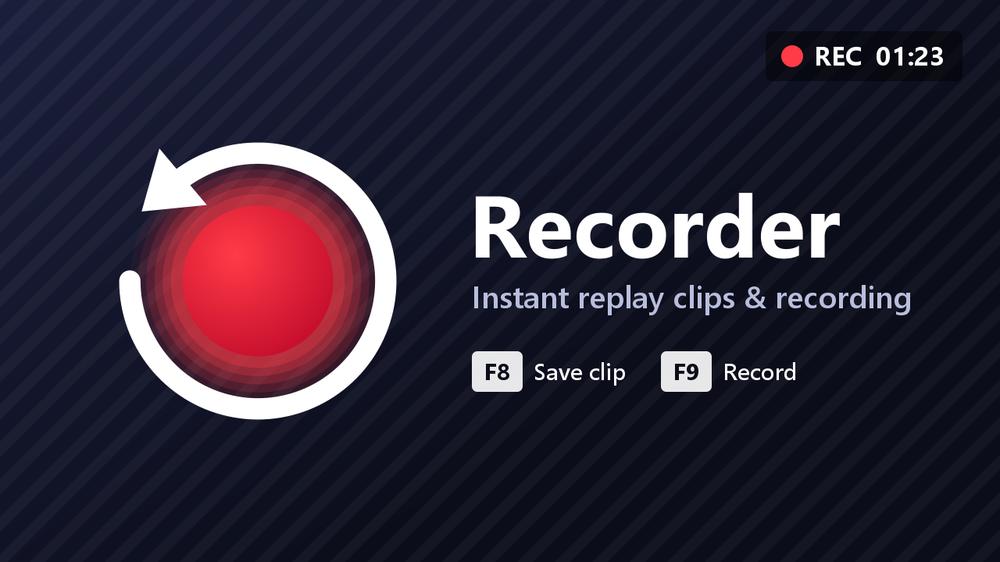

# Recorder



A Laby Client addon that records your game in the style of Medal or ShadowPlay.

- **Instant Replay:** the last seconds are always kept in memory. Press **F8** to save them as a clip.
- **Recording:** press **F9** to start and stop a full recording.
- **HUD widget:** shows whether Instant Replay or a recording is running, the recording time and how
  many seconds a clip would hold. Add it in the HUD widget editor under *Recorder*.
- **Command:** `/recorder clip|record|folder` (alias `/rec`).

Videos are saved to `.minecraft/recordings/` as Motion JPEG AVI files. They play in VLC and the
Windows media player and open in common video editors. To get a smaller mp4:

```
ffmpeg -i clip.avi -c:v libx264 -crf 20 clip.mp4
```

## Settings

| Setting | Default |
|---------|---------|
| Instant Replay | on |
| Save Clip key | F8 |
| Clip Length | 30 s (5 to 120) |
| Start / Stop Recording key | F9 |
| Resolution | 720p (480p, 720p, 1080p, window size) |
| Frame Rate | 30 (10 to 60) |
| Quality | 80 |
| Notifications | on |

## How it works

Frames are read from the main render target without stalling the GPU (two pixel buffer objects
in turn, or the Laby Client's `ScreenRegionCapture` where a version provides one). A background
thread scales them down and compresses them to JPEG, another one writes them to disk. When the
encoder can't keep up, frames are dropped instead of queued, and the video repeats the previous
frame, so it always plays in real time.

The replay buffer is capped at 1 GB of memory. Audio is not recorded.

## Building

```
./gradlew build createReleaseJar
```

The release jar is written to `build/libs/*-release.jar`. Run a dev client with
`./gradlew :game-runner:client_v1.21.11`.
